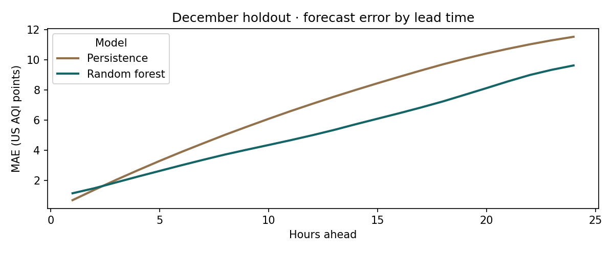
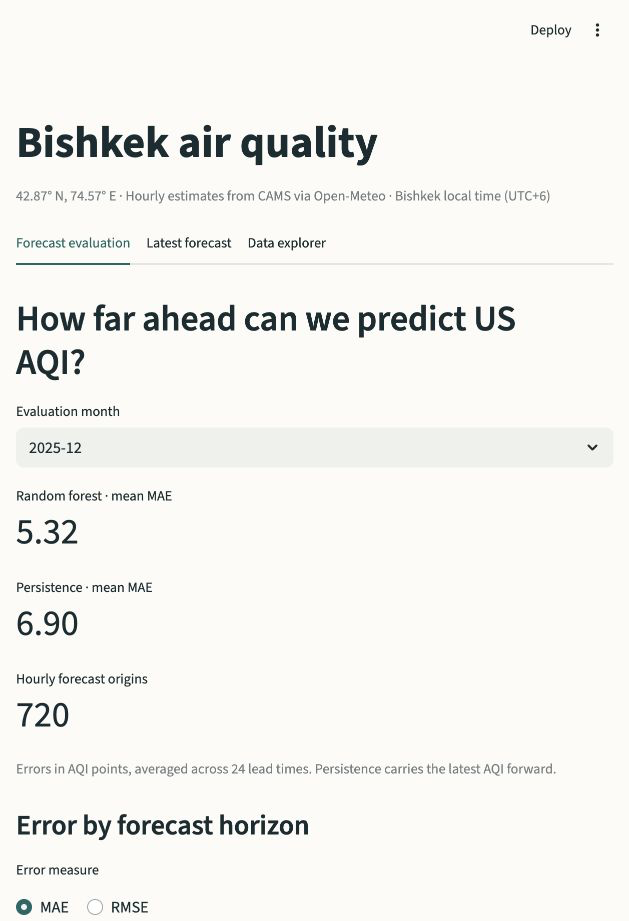

# Bishkek air quality forecasting

**How far ahead does a random forest improve on carrying the latest US AQI forward?** On the December 2025 holdout, the forest reduced mean absolute error by 23.0%, from 6.90 to 5.32 AQI points across 24 lead times. Persistence had the lowest error at one and two hours, and the forest won at every lead from three through 24 hours.



| December test set | MAE | RMSE |
|---|---:|---:|
| Persistence | 6.90 | 9.13 |
| Multi-output random forest | 5.32 | 7.33 |

Each metric pools 720 hourly forecast origins and 24 horizons. MAE gives the typical absolute miss in AQI points. RMSE gives larger misses more weight. Forecast windows overlap, so the 17,280 forecast errors are correlated.

## What the model predicts

For one grid location in Bishkek (42.8746° N, 74.5698° E), each output predicts Open-Meteo's overall US AQI for a specific future hour. The provider calculates this index across pollutants. PM2.5 is one pollutant concentration, measured in micrograms per cubic meter. It enters the forest as a predictor alongside PM10. The target and the historical inputs come from archived atmospheric-model estimates. Independent station measurements and original publication times would be needed to validate performance against on-the-ground conditions and operational data availability. Data courtesy of CAMS via [Open-Meteo](https://open-meteo.com/en/docs/air-quality-api).

## Model and evaluation

The original prototype trained a separate random forest for each horizon on a PM2.5-derived index. This version uses a single scikit-learn multi-output RandomForestRegressor. Each tree groups similar historical conditions and returns a 24-hour trajectory averaged over the examples in its leaf. Averaging 80 bootstrap trees stabilizes those predictions. Maximum depth is 12, minimum leaf size is five, and the random seed is 42.

Inputs include current US AQI, PM2.5, PM10, AQI one, three and 24 hours earlier, local hour and month. Training and live prediction call the same feature function. An hourly time grid preserves gaps; incomplete examples are excluded. The 2025 snapshot contains 8,760 hourly timestamps.

Training expands from January to each test boundary (July 1, October 1 and December 1). Every training row's final target precedes that boundary. Each test origin has all 24 targets inside its test month. December is the final holdout. Only after scoring do we refit the dashboard model on the full archive. [Per-month and per-horizon results](reports/metrics.csv)

Short-horizon persistence is hard to beat here. In December, the index moved only 0.70 points in absolute terms on average over the next hour, while the forest missed by 1.16. After 24 hours the average change had grown to 11.52 points and the forest missed by 9.62. Leaf averaging can smooth small near-term changes; isolating that mechanism would require a separate experiment. This comparison establishes performance against persistence only.

## Dashboard



Explore MAE and RMSE by month and horizon, download tables, inspect the hourly archive, or load a recent forecast. Recent forecasts exclude future input rows and show their local origin time. The research view runs from the bundled snapshot even when the API is unavailable.

## Run and reproduce

From the repository root, create a Python 3.11 environment and install the pinned packages.

```sh
python3.11 -m venv .venv
source .venv/bin/activate
python -m pip install -r requirements.txt
python -m streamlit run app/dashboard.py
```

Run the experiment on the included snapshot to regenerate the metrics, chart and fitted forest.

```sh
python -m src.train_model
```

To retrieve a fresh copy of the historical source, run `python -m src.fetch_data`. The provider can revise historical values, so use the bundled CSV to reproduce the reported numbers. Older files in data/processed and models/aqi_model* belong to the original prototype.

## Publish the app

Deployment runs the Python app on a hosted computer so readers can visit it while your laptop is off. Push the project files, including the fitted forest, archive and reports, to GitHub. In Streamlit Community Cloud, connect GitHub, choose Create app, select the repository and branch, set the entry point to `app/dashboard.py`, and choose Python 3.11 under advanced settings. Deploy, check that viewing permissions allow anyone with the link, and open the resulting URL in a signed-out browser before sharing it. Community Cloud offers free hosting. [Hosting guide](https://docs.streamlit.io/deploy/streamlit-community-cloud)
